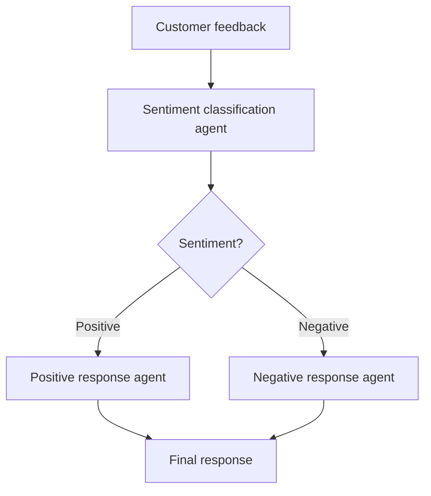

# Multi-Agent Customer Feedback Lab

A browser-based teaching application demonstrating **LLM-powered task specialization and conditional routing with LangGraph**. Built with Python, Streamlit, and Groq-hosted `openai/gpt-oss-20b`, it classifies customer feedback and generates a response using the appropriate specialist agent.

**Live application:** https://multi-agent-classroom.streamlit.app/

## What the application does

1. A user enters customer feedback in the Streamlit interface.
2. The **sentiment agent** classifies the feedback as `Positive` or `Negative` (choosing the dominant sentiment if mixed).
3. LangGraph selects one of two branches:
   - **Positive response agent:** thanks the customer in a concise, professional manner.
   - **Negative response agent:** acknowledges the problem, apologizes, and invites follow-up without promising unauthorized compensation.
4. The interface displays the classification, selected agent, generated response, and workflow state.



Each completed workflow normally makes **two LLM requests**: classification followed by one response-generation call. All three specialist functions share the same underlying hosted model; they differ in their instructions and responsibilities. This is a **graph-orchestrated, multi-agent teaching example**, not an autonomous system with independent models or external tools.

## Technology

- **Python 3.11** — application language
- **Streamlit** — interactive web interface
- **LangGraph** — workflow state, nodes, and conditional edges
- **Groq Python SDK** — hosted model inference
- **`openai/gpt-oss-20b`** — default open-weight model served through Groq (not the OpenAI API)

The Groq service requires an API key. Free-tier usage is subject to model availability and account-specific rate limits; free hosting and free API quotas are not unlimited.

## Project structure

```text
multi-agent-classroom/
├── app.py             # Streamlit user interface
├── agents.py          # Groq calls and three specialist agent functions
├── workflow.py        # LangGraph state, nodes, and routing
├── requirements.txt   # Python dependencies
├── README.md          # Documentation
└── .gitignore         # Files excluded from Git
```

## Run locally

1. Install Python 3.11 and clone the repository.
2. Create a virtual environment (recommended), activate it, and install dependencies:

   ```bash
   python -m pip install -r requirements.txt
   ```

3. Set the environment variable `GROQ_API_KEY` to your key. Optionally set `GROQ_MODEL=openai/gpt-oss-20b`.
4. Start the application:

   ```bash
   streamlit run app.py
   ```

5. Open the local URL shown in the terminal.

The app reads the API key from environment variables or Streamlit secrets. Never commit keys to GitHub or paste them into public logs.

## Deploy to Streamlit Community Cloud

1. Push the project files to a GitHub repository with `app.py` at its root.
2. Open https://share.streamlit.io/ and create an application from the repository, using branch `main` and main file path `app.py`.
3. Select **Python 3.11** in advanced settings.
4. In **Secrets**, enter the following TOML, replacing the placeholder with your own key:

   ```toml
   GROQ_API_KEY = "your_groq_api_key_here"
   GROQ_MODEL = "openai/gpt-oss-20b"
   ```

5. Deploy and test both positive and negative examples. Streamlit installs packages from `requirements.txt`.

Create and manage your Groq API key at https://console.groq.com/keys. Consult https://console.groq.com/docs/rate-limits for published limits and your account dashboard for applicable quotas.

## Try it

**Positive feedback:**

> I love your service! The staff were helpful.

**Negative feedback:**

> I hate your services. The delivery was late.

Expected behavior: the first message follows the positive branch and the second follows the negative branch. Exact response wording can vary between model calls.

## Code walkthrough

### `agents.py`

- `ask_llm(system_prompt, feedback, max_tokens=400)` sends a system instruction and feedback to the Groq chat-completions API. It requests low reasoning effort and checks for an empty visible response.
- `sentiment_agent(feedback)` asks the model for exactly `Positive` or `Negative`, normalizes minor formatting differences, and raises an error if the output cannot be validated.
- `positive_agent(feedback)` generates a thank-you response.
- `negative_agent(feedback)` generates a professional apology and follow-up invitation.

### `workflow.py`

- `FeedbackState` defines `feedback`, `sentiment`, and `response` fields.
- `classify` updates the sentiment field.
- `route` checks the sentiment and selects `positive` or `negative`.
- `respond_positive` and `respond_negative` generate the response.
- `StateGraph` connects `START → classify → selected response node → END`.
- `run_workflow(feedback)` invokes the compiled graph and returns its state.

### `app.py`

The Streamlit interface accepts input, runs the graph, handles errors, and shows the resulting state for inspection.

## Classroom exercises

1. Identify the graph's nodes, state variables, start/end points, and conditional edges.
2. Test positive, negative, and mixed feedback. Discuss how the dominant sentiment is selected.
3. Add a **Neutral** classification, a neutral-response agent, and a third conditional route.
4. Change the system prompts and compare generated responses.
5. Test malformed or adversarial feedback and discuss output validation and prompt-injection defenses.
6. Measure request latency and estimate the number of API calls needed for a class demonstration.

## Operational considerations

- **Rate limits:** Each successful run usually makes two Groq API requests. Multiple simultaneous students can reach free-tier limits quickly.
- **Model output:** LLM responses are not guaranteed to follow instructions perfectly. The classifier validates labels and reports unexpected outputs instead of silently routing them.
- **Reasoning tokens:** The classifier allocates enough completion tokens for the selected reasoning model; an empty visible response is treated as an error.
- **Security:** Feedback is sent to Groq for processing. Avoid entering confidential customer information or real personal data in this classroom demonstration.
- **Reliability:** Internet access, Groq service availability, and Streamlit hosting are required. Test the deployment before teaching.
- **Scope:** This is an educational prototype, not a production customer-service system. Human review and business authorization are required for consequential customer actions.

## License

No repository-wide license is specified here. Add a `LICENSE` file if you want to grant others explicit permission to reuse or redistribute the project.
